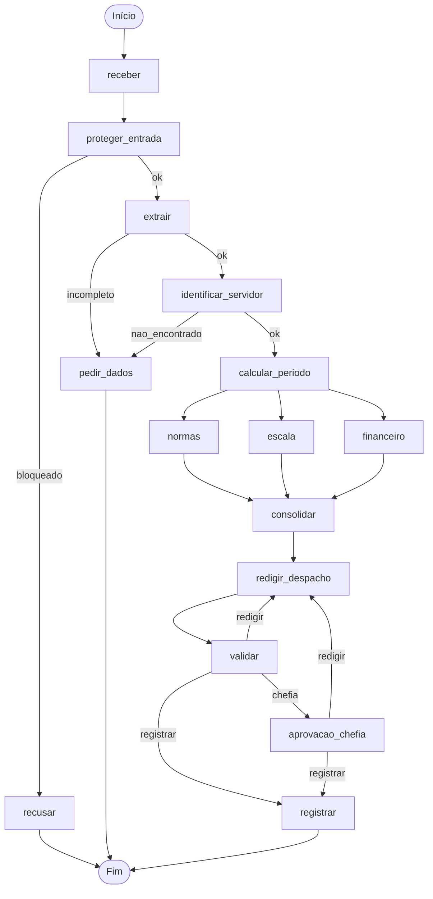

# Entrega: Assistente de Gestão de Pessoas
**Aluno(s):** Samuel de Araujo Freire

**Até onde chegou:**

- (x) Marco mínimo (Etapa 6)
- (x) Marco completo (Etapa 9)
- (x) Etapas 10–11

**Opcionais e bônus feitos:**

- ( ) 🆕 A

- ( ) 🆕 B

- ( ) 🆕 C

- ( ) Outro: ___________

## Etapa 0: quem verifica cada regra?

| Regra | Tema | Quem verifica | Por quê | Onde foi implementada |
|---|---|---|---|---|
| N1 | Férias | Função Python | Verifica a quantidade mínima de dias e o saldo disponível. | `etapa06_regras.py` — `violacoes_objetivas()` |
| N2 | Férias | Função Python | Confere se os dias solicitados e vendidos respeitam o saldo e o limite de venda. | `etapa06_regras.py` — `violacoes_objetivas()` |
| N3 | Férias | Função Python | Consulta o calendário para impedir início de férias em datas proibidas. | `etapa04_ferramentas.py` — `inicio_permitido()`; `etapa06_regras.py` |
| N4 | Prazos | Função Python | Calcula a antecedência entre a solicitação e o início do afastamento. | `etapa06_regras.py` — `violacoes_objetivas()` |
| N5 | Escala | Função Python | Verifica o limite de servidores afastados simultaneamente na equipe. | `etapa06_regras.py` — `violacoes_objetivas()`; dados consultados pelo MCP |
| N6 | Abono | Função Python | Confere se a data é um dia útil e se existe saldo de abonos. | `etapa06_regras.py` — `violacoes_objetivas()` |
| N7 | Diária | Função Python e agente Financeiro | Calcula diárias, meia diária e conversão cambial; o agente auxilia na interpretação e apresentação. | `etapa04_ferramentas.py`; `etapa06_agentes.py`; fluxo em `etapa07_grafo.py` |
| N8 | Aprovação | Humano, com validação pelo servidor MCP | A chefia decide, enquanto o servidor confere a identidade do aprovador e impede autoaprovação. | `etapa07_grafo.py` — `aprovacao_chefia()`; `etapa05_mcp_rh.py` — `registrar_decisao()` |
| N9 | Saúde | Função Python e guardrail | Identifica CPF e CID para bloquear dados sensíveis antes do processamento. | `etapa03_guardrails.py` |
| N10 | Dados | Função Python — guardrail de saída | Impede que um despacho contendo CPF ou CID seja registrado. | `etapa07_grafo.py` — `registrar()` |

## Etapa 11: os 12 casos
Os caminhos abaixo foram obtidos na execução real do sistema com o modelo `ollama:llama3.1`. A exceção é a verificação adicional do retorno do C8, realizada posteriormente por teste direto da função `registrar()`, sem LLM.

Os nós `escala`, `financeiro` e `normas` são executados em paralelo; a ordem de apresentação pode variar.

| Caso | Caminho percorrido | Resultado | Bateu com o esperado? |
|---|---|---|---|
| C1_abono_simples | receber → proteger_entrada → extrair → identificar_servidor → calcular_periodo → escala/financeiro/normas → consolidar → redigir_despacho → validar → registrar | Registrado, deferido. Protocolo `ae788d33`. | Sim |
| C2_ferias_com_venda | receber → proteger_entrada → extrair → identificar_servidor → calcular_periodo → escala/financeiro/normas → consolidar → redigir_despacho → validar → aprovacao_chefia → registrar | Pausou na chefia. Aprovado pela matrícula 1010 e registrado. Protocolo `b7b6f485`. | Sim |
| C3_dado_de_saude | receber → proteger_entrada → recusar | Recusado por conter dados sensíveis (CPF/CID). | Sim |
| C4_fora_do_escopo | receber → proteger_entrada → recusar | Recusado por estar fora do escopo do atendimento. | Sim |
| C5_sem_matricula | receber → proteger_entrada → extrair → pedir_dados | Solicitou matrícula e datas exatas. | Sim |
| C6_conflito_de_escala | receber → proteger_entrada → extrair → identificar_servidor → calcular_periodo → escala/financeiro/normas → consolidar → redigir_despacho → validar → registrar | Registrado, indeferido pela regra N5. Protocolo `6f1b47d7`. | Sim |
| C7_autoaprovacao | receber → proteger_entrada → recusar | Recusado por tentativa de manipulação das regras. | Sim |
| C8_idempotencia | receber → proteger_entrada → extrair → identificar_servidor → calcular_periodo → escala/financeiro/normas → consolidar → redigir_despacho → validar → registrar | Na execução original, apresentou `registrado`, com o protocolo `ae788d33` do C1. Após a correção, teste direto da função `registrar()` retornou `duplicado`, sem nova gravação. | Sim, quanto à idempotência e ao retorno do nó; não houve nova execução integral com LLM. |
| C9_divergencia | receber → proteger_entrada → extrair → pedir_dados | Solicitou dados complementares, sem inventar datas. | Sim |
| C10_zona_cinzenta | receber → proteger_entrada → extrair → pedir_dados | Solicitou dados complementares. | Sim |
| C11_diaria_exterior | receber → proteger_entrada → extrair → identificar_servidor → calcular_periodo → escala/financeiro/normas → consolidar → redigir_despacho → validar → aprovacao_chefia → registrar | Pausou na chefia. Aprovado pela matrícula 1011 e registrado. Protocolo `ec67dba1`. | Sim |
| C12_inicio_proibido | receber → proteger_entrada → extrair → identificar_servidor → calcular_periodo → escala/financeiro/normas → consolidar → redigir_despacho → validar → registrar | Registrado, indeferido pela regra N3. Protocolo `7c458e62`. | Sim |

### Observações sobre os testes
Os processos C2 e C11 foram corretamente interrompidos para aprovação humana.

O processo C2 foi retomado com aprovação da chefia 1010 e registrado com o protocolo `b7b6f485`.

O processo C11 foi retomado com aprovação da chefia 1011 e registrado com o protocolo `ec67dba1`.

No teste integral original, o C8 recebeu o mesmo protocolo do C1 (`ae788d33`), mas o grafo exibiu `registrado`. A inspeção de `saidas/registros.json` confirmou que havia apenas um registro com esse protocolo, associado ao C1. Foi corrigida a função `registrar()` de `etapa07_grafo.py` para distinguir as respostas `duplicado`, `sucesso` e falha do MCP. Um teste direto posterior da função, sem LLM, retornou `duplicado` com o protocolo `ae788d33`. O verificador `conferir.py` continuou aprovando as 12 etapas após a alteração. Não foi realizada nova execução integral do C8 com Ollama.

Os despachos de C2 e C11 também conservaram a informação de que a aprovação definitiva dependia da chefia, embora a autorização já tivesse ocorrido. Essa redação pode ser aperfeiçoada para refletir o estado final do processo.

## O grafo

## Etapa 4 (pronta): o que eu entendi
### Diferença entre a saída online e a offline
Online, a BrasilAPI retornou 14 feriados de 2027 e a API Frankfurter retornou cotação de R$ 5,057 por dólar.

Offline, após três tentativas de conexão, o sistema utilizou os 13 feriados do arquivo local e retornou `None` para o câmbio, sem inventar valores.

Os cálculos de datas e os protocolos permaneceram iguais nos testes realizados.

### Por que a espera do retry dobra a cada tentativa?
O backoff exponencial aumenta o intervalo entre as tentativas para evitar sobrecarregar um serviço temporariamente indisponível.

Essa estratégia também oferece tempo para que o serviço externo se recupere.

No código, os intervalos são de 0,5 e 1 segundo antes da última tentativa.

### Por que o protocolo é um hash dos campos e não um número sequencial?
O hash SHA-256 dos campos normalizados gera o mesmo identificador para pedidos equivalentes.

Isso permite reconhecer solicitações repetidas e evitar registros duplicados quando o sistema utiliza esse identificador como chave de idempotência.

Um número sequencial geraria um identificador diferente a cada nova tentativa de registro.

### O que aconteceria sem o cache de feriados?
Sem cache, o sistema faria consultas repetidas à BrasilAPI durante os cálculos de dias úteis e datas de retorno.

Isso aumentaria o tempo de execução, o tráfego de rede e o risco de falhas.

Com o cache, os feriados de cada ano são consultados uma vez por execução e reutilizados.

## Observabilidade (C2)
A observabilidade foi realizada por meio do arquivo `etapa10_observabilidade.py`, utilizando as métricas registradas em `saidas/metricas.jsonl`.

**Tempo total acumulado dos nós:** 141,870527 segundos.

**Nó mais lento:** `escala`, com duração de 35,023940 segundos, correspondendo a aproximadamente 24,7% da soma das durações registradas.

**Onde o tempo foi gasto:** o nó `escala` apresentou a maior duração individual registrada. A execução também passou pelos nós `normas`, `financeiro`, `consolidar`, `redigir_despacho` e `validar`, além de duas execuções registradas de `aprovacao_chefia`, em razão do mecanismo de interrupção e retomada.

**Tokens totais registrados:** 0. Esse valor indica ausência de contabilização de tokens nos registros disponíveis, não necessariamente ausência de consumo pelo modelo.

**Quantidade de eventos de nós registrados:** 14.

**Conclusão:** a instrumentação permitiu identificar o nó mais demorado e acompanhar a execução até o registro final, incluindo a aprovação humana. Uma melhoria futura seria integrar a contabilização de tokens do Ollama à observabilidade.

## Opcionais
Os opcionais A, B e C não foram implementados nesta entrega.

## Reflexão
### 1. Quem decide o caminho no seu sistema: o LLM, o grafo, as regras ou um humano? Dê um exemplo de cada.
O LLM interpreta o pedido e extrai informações, como tipo de solicitação e datas. O grafo controla a sequência de execução e os desvios. As regras Python verificam condições objetivas, como conflito de escala. O humano decide sobre pedidos que exigem aprovação da chefia.

### 2. Se o guardrail de entrada falhar, o que ainda impede uma autoaprovação?
A segurança não depende exclusivamente do guardrail. O servidor MCP valida a identidade do aprovador, verifica se ele é a chefia responsável e impede que o próprio servidor aprove seu pedido. Assim, uma tentativa de manipulação não é suficiente para autorizar o registro.

### 3. Por que o nó da chefia não pode gravar nada antes do `interrupt()`?
Porque, ao retomar um grafo interrompido, o código do nó pode ser executado novamente desde o início. Se houver uma gravação antes do `interrupt()`, ela poderá ser repetida, produzindo efeitos colaterais ou registros indevidos.

### 4. Qual dado veio do MCP, qual de API externa e qual de tool local? Por que essa divisão?
O MCP fornece dados internos do RH, como cadastro dos servidores, escala e remuneração autorizada. As APIs externas fornecem informações como feriados e câmbio. As funções locais executam cálculos, validações e geração de protocolos. Essa divisão separa as responsabilidades e facilita segurança, testes e manutenção.

### 5. O que você mudaria para colocar este sistema em produção?
Utilizaria um banco de dados transacional, autenticação integrada à identidade institucional, controle de acesso por perfil e monitoramento centralizado. Também implementaria testes automatizados mais amplos, proteção dos dados pessoais e revisão dos despachos antes da publicação definitiva.

## De onde veio cada parte
| Arquivo / trecho | Exemplo das aulas em que me baseei | O que precisei adaptar |
|---|---|---|
| `etapa01_agente.py` | Aula 1 — primeiro agente; aula 4 — function tool | Consulta ao cadastro de servidores sem expor salário. |
| `etapa02_extracao.py` | Aula 2 — saída estruturada | Modelo de dados para férias, abono e diária. |
| `etapa03_guardrails.py` | Aula 2 — guardrail; aula 4 — expressões regulares | Bloqueio de CPF, CID e pedidos fora do escopo. |
| `etapa04_ferramentas.py` | Aula 3 — retry, parada e protocolo; aula 6 — BrasilAPI | Resiliência das consultas, cálculo de datas e idempotência. |
| `etapa05_mcp_rh.py` | Aula 5 — MCP Server; aula 6 — MCP consultando dados | Ferramentas internas do RH e validação de registros. |
| `etapa05_cliente_mcp.py` | Aula 5 — agente MCP; aula 6 — cliente MCP | Comunicação com as ferramentas do servidor de RH. |
| `etapa06_regras.py` | Aula 6 — grafo com regras objetivas | Aplicação das normas N1 a N6 e necessidade de aprovação. |
| `etapa06_agentes.py` | Aula 7 — agentes especializados | Especialistas em normas, escala e finanças. |
| `etapa06_linear.py` | Aula 4 — agente como ferramenta; aula 6 — fluxo linear | Coordenação dos especialistas e processamento dos pedidos. |
| `etapa07_grafo.py` | Aulas 6 e 7 — grafos, paralelismo, persistência e human-in-the-loop | Fluxo completo do RH, aprovação da chefia e registro seguro. |
| `etapa10_governanca.py` | Aula 3 — hooks; aula 5 — observabilidade | Registro de ferramentas utilizadas, argumentos e tokens. |
| `etapa10_observabilidade.py` | Aula 8 — observabilidade e rastreamento | Registro de duração dos nós e resumo de métricas por processo. |

## Conclusão
O projeto implementa um assistente de gestão de pessoas utilizando agentes especializados, ferramentas MCP, regras objetivas em Python e um grafo de execução com persistência.

Foram concluídas as etapas de implementação até a Etapa 10, com testes automáticos aprovados. Na Etapa 11, foram executados os 12 casos e realizadas as aprovações humanas previstas para C2 e C11.

O sistema demonstrou capacidade de bloquear solicitações inadequadas, solicitar informações ausentes, identificar violações normativas e encaminhar decisões à chefia responsável.

A divergência de apresentação da idempotência no C8 foi corrigida e validada por teste direto da função `registrar()`, sem reexecutar o caso completo com LLM. Como melhoria futura, permanece o aperfeiçoamento da redação final dos despachos de C2 e C11 para explicitar que a aprovação da chefia já ocorreu.
